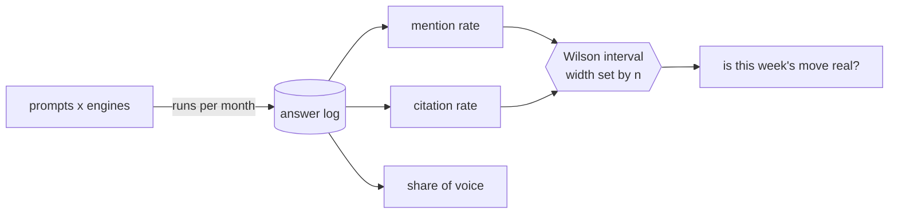

# Best LLM Tracking Tools

<p align="center">
  <a href="https://aiclicks.io/">
    
  </a>
</p>

Every chart in an LLM visibility dashboard is an estimate built from a sample of answers, and most vendors never tell you how big that sample is. This repo compares the [best LLM tracking tools](https://aiclicks.io/blog/best-tools-for-tracking-llm-visibility) on the numbers that decide whether their charts mean anything: how answers are collected, how many answers the entry plan buys, what one thousand answers cost, and how wide the error bar is on a single prompt. Then it gives you the code to check those numbers against your own data.

A prompt that a tracker runs once a day on one engine collects 30 answers a month. At a true visibility of 30%, the 95% interval on that prompt runs from about 17 to 48 percent. A tool that refreshes weekly collects 4 answers, and the interval stretches from 5 to 70 percent. When a dashboard shows a prompt moving from 25% to 40% in a week, that is usually sampling noise. The math is short, so it ships here as a dependency free Python package.

```
.
├── tools.yaml               10 trackers, entry plan facts only
├── render_table.py          tools.yaml -> both README tables, --check, --answers
├── llmvis/
│   ├── stats.py             Wilson interval, two proportion test, sample size planner
│   └── score.py             answer log -> mention, citation, share of voice with intervals
├── examples/
│   ├── answers.example.jsonl  672 synthetic answers, fictional brands
│   ├── brand.example.json     brand, aliases, domains, competitors
│   └── make_sample.py         seeded generator for the log above
├── tests/                   unittest, no network
└── .github/workflows/       table check, tests on Python 3.9 and 3.12, link check
```

## What a tracker actually measures

An LLM tracker sends a fixed list of prompts to a set of engines on a schedule and stores each answer. Everything on the dashboard is a count over those stored answers.

| Metric | Formula over the answer log | What it misses |
| --- | --- | --- |
| Mention rate (visibility) | answers naming the brand / answers collected | Position inside the answer, tone |
| Citation rate | answers linking a brand domain as a source / answers collected | Engines that answer from training data without sources |
| Share of voice | brand appearances / all tracked brand appearances | Competitors you did not add to the config |

[AIclicks documents its own versions](https://docs.aiclicks.io/metrics-overview) of these, and visibility there is total brand mentions divided by answers collected. Other vendors use the same idea under different names, such as "Share of Model" or "AI Visibility Score". The Semrush score also counts unlinked mentions alongside citations, so its number will not line up with a citation rate from another tool.

The sample size behind each number is `prompts x engines x runs`. That one product drives the price of every plan below and the reliability of every chart, and it is the first thing to check when you compare tools for LLM visibility.



## Collection method changes the answer

Two ways to get an answer out of an engine produce two different answers.

**Through the live interface.** The tool drives the same chat surface a buyer uses, with web retrieval on, so the answer includes the sources that the engine actually fetched. Peec AI and Allmond say they work this way. Allmond goes one step further and runs four to five scans per prompt, then averages them, which is the only built in variance control on this list.

**Through the model API.** The tool calls the model directly. That is cheaper and easier to run at volume, but a bare model API call often skips the retrieval layer, which means no citations and an answer based on training data. Qwairy labels every engine as API or UI and is open that Claude, Mistral and DeepSeek are API only on its platform, so those three scores leave out live retrieval and citations.

Most vendors do not publish their method. The table marks those `Not published`. If you are running a citation strategy, ask before you buy, because an API only score tells you little about which pages an engine cites.

## Comparison

The **One prompt, one engine, one month** column is computed by [render_table.py](render_table.py). It is the half width of the 95% Wilson interval for a prompt at 30% visibility, given how many answers that prompt gets on one engine per month at the plan's refresh rate.

<!-- TABLE:START -->
| Tool | What you get | Engines at entry | Collection | Refresh | One prompt, one engine, one month | API and export | Output |
| --- | --- | --- | --- | --- | --- | --- | --- |
| [AIclicks](https://aiclicks.io) | Dashboard plus execution agents | 3 of 10, you pick | Not published | Daily | ±16 pts (n=30) | Private API on Business, MCP server | Execution, publishing and outreach |
| [Qwairy](https://www.qwairy.co) | Dashboard | 10, no add ons | Mixed, labelled per engine | Not stated | n/a | REST API on Growth, €199 | Briefs |
| [Scrunch AI](https://scrunch.com) | Dashboard plus CDN layer | 4 (ChatGPT, Perplexity, AI Overviews, Copilot) | Not published | Not stated | n/a | Data API on Enterprise only | Reports, page audits |
| [Allmond](https://allmond.app) | Dashboard | 4 (ChatGPT, Claude, Gemini, Perplexity) | Live ChatGPT interface | Weekly | ±21 pts (n=16) | Not stated | Client reports, no login needed |
| [Rank Prompt](https://rankprompt.com) | Dashboard plus content | 6, all on paid plans | Not published | Weekly | ±33 pts (n=4) | Not stated | Content and outreach, shared credit pool |
| [Profound](https://www.tryprofound.com) | Dashboard plus content agents | 1 (ChatGPT only) | Not published | Daily | ±16 pts (n=30) | No exports on Starter | Content agents, crawler analytics |
| [Semrush AI Visibility Toolkit](https://www.semrush.com/kb/1493-ai-visibility-toolkit) | SEO suite module | 4, extra domains and seats $99 each | Not published | Daily | ±16 pts (n=30) | Not stated | Reports, AI search site audit |
| [SE Ranking](https://seranking.com) | SEO suite module | 4 (AI Overviews, AI Mode, ChatGPT, Perplexity) | Not published | Weekly | ±33 pts (n=4) | Not stated | Reports inside the SEO suite |
| [Peec AI](https://peec.ai) | Dashboard | 3, extra models from $35 each | Live assistant interfaces | Daily | ±16 pts (n=30) | API on Enterprise, MCP server | Reports |
| [cloro](https://cloro.dev) | Raw answer API, no dashboard | 9 surfaces, no Claude | Engine surfaces, parsed to JSON | On demand | n/a | The product is the API, Python and JS, MCP server | Raw JSON with sources and fan out queries |
<!-- TABLE:END -->

## What one thousand answers cost

Pricing pages count in prompts, credits, scans or responses. This table converts each entry plan to answers per month where the public numbers allow it, then divides the price. Where a credit cannot be turned into a number of answers from public pages, the cell says so instead of guessing.

<!-- COST:START -->
| Tool | Entry plan | Price | Answers per month | How it was derived | Cost per 1,000 answers | Trial |
| --- | --- | --- | --- | --- | --- | --- |
| AIclicks | Starter | $59/mo, monthly | 2,700 | 30 prompts x 3 engines x 30 runs | $21.85 | 3 days |
| Qwairy | Starter | €79/mo, monthly | n/a | 1,300 credits, unit not convertible | n/a | Free plan, 120 credits |
| Scrunch AI | Starter | $300/mo, monthly, $250 billed yearly | n/a | unit not convertible | n/a | 7 days, no card |
| Allmond | Starter | $29/mo, monthly | 240 | vendor cap | $120.83 | 7 days |
| Rank Prompt | Starter | $49/mo, monthly | n/a | 150 credits, unit not convertible | n/a | 7 days, 50 credits, card required |
| Profound | Starter | $99/mo, billed yearly | 1,500 | vendor cap | $66 | None on Starter |
| Semrush AI Visibility Toolkit | Standalone toolkit | $99/mo, billed yearly, per domain | 3,000 | 25 prompts x 4 engines x 30 runs | $33 | None |
| SE Ranking | Entry suite plan | $129/mo, monthly | n/a | unit not convertible | n/a | 14 days |
| Peec AI | Starter | $95/mo, monthly | 4,500 | 50 prompts x 3 engines x 30 runs | $21.11 | 7 days |
| cloro | Hobby | $100/mo, monthly | 50,000 | 250,000 credits / 5 per answer | $2 | Free plan, 500 credits a month |
<!-- COST:END -->

Two notes on the derivation. AIclicks publishes a cap of 4,650 responses a month on Starter, which is above what 30 prompts on 3 engines use in a month, so the table prices the usage figure, not the cap. The cloro figure assumes 5 credits per answer, its published async rate for ChatGPT with web search, Copilot and AI Overviews. Perplexity, Gemini and AI Mode cost 4, so the real number lands a little lower.

Filter by the volume you need:

```bash
pip install pyyaml
python render_table.py --answers 2500
```

```
cloro                             50,000 answers  $2 per 1,000
Peec AI                            4,500 answers  $21.11 per 1,000
AIclicks                           2,700 answers  $21.85 per 1,000
Semrush AI Visibility Toolkit      3,000 answers  $33 per 1,000
```

Cost per answer is only half the comparison. cloro is ten times cheaper per answer because it hands you raw JSON and stops there, so the dashboard, the scoring and the follow up work become your job.

## How big a sample you need

Interval half width at 30% visibility, from `llmvis.stats`:

| Answers (n) | ± points | Typical source of that n |
| ---: | ---: | --- |
| 4 | 33 | one prompt, one engine, weekly refresh |
| 16 | 21 | same, with four scans per run |
| 30 | 16 | one prompt, one engine, daily refresh |
| 90 | 9 | one prompt across three engines, daily |
| 360 | 5 | twelve prompts pooled across one engine, daily |
| 900 | 3 | thirty prompts pooled on one engine, daily |

To see a move from 30% to 40% at the usual 5% significance level and 80% power you need 356 answers in each period. A 5 point move needs 1,377. Plan the comparison before you blame or credit a content change:

```bash
python -m llmvis.stats plan --baseline 0.30 --lift 0.10 --per-day 90
```

```
356 answers per period to detect 30.0% -> 40.0% at alpha 0.05 and power 0.8
at 90 answers a day that is 4 days per period, pooled across prompts and engines
```

The practical rule: read single prompts as direction only, and judge changes on pooled groups such as a topic, an engine, or the whole plan, over windows long enough to hit the sample size above.

## Score your own answer log

`llmvis.score` reads JSON Lines or CSV with `date`, `engine`, `prompt`, `text` and `sources`. That shape matches a CSV export from most trackers after a column rename, or the response of an answer API. The brand file lists aliases and domains, and alias matching uses word boundaries so `Orbit` never counts as `Orbitly`.

```bash
python -m llmvis.score examples/answers.example.jsonl --brand examples/brand.example.json --by engine --diff
```

```
engine        answers  mention rate [95% CI]  citation rate [95% CI]  share of voice
------------  -------  ---------------------  ----------------------  --------------
ai-overviews  168       36.3% [29.4, 43.8]     28.6% [22.3, 35.8]     15.0%
chatgpt       168       39.3% [32.2, 46.8]      8.9% [ 5.5, 14.2]     15.6%
gemini        168       20.2% [14.9, 26.9]      1.2% [ 0.3,  4.2]     9.6%
perplexity    168       29.8% [23.4, 37.1]     26.8% [20.7, 33.9]     13.1%

mention rate, 2026-W42 -> 2026-W43, alpha 0.0500
  ai-overviews    18/42  ->  15/42    -7.1 pts  p=0.503  noise
  chatgpt         19/42  ->  11/42   -19.0 pts  p=0.069  noise
  gemini           3/42  ->  10/42   +16.7 pts  p=0.035  CHANGE
  perplexity      11/42  ->  21/42   +23.8 pts  p=0.025  CHANGE
```

The sample log is seeded with one real change: Perplexity's true rate goes from 25% to 55% in the last week. Gemini's true rate never moves, yet it gets flagged too. That is a false positive, and it is what happens when four engines are each tested at 5%. ChatGPT drops 19 points on a flat true rate and only just escapes. Add `--bonferroni` and alpha becomes 0.0125, which clears both flags. One week of 42 answers per engine is not enough to confirm even the 30 point Perplexity jump once you correct for testing four engines. That is the sample size table above showing up in real output.

Other views: `--by prompt`, `--by week`, `--by overall`.

## The ten tools, read as instruments

Notes below cover how each tool collects data, what it costs, and the limit you will run into first. AIclicks is listed first because the shortlist comes from its own roundup, and that is disclosed in the credits.

### 1. AIclicks

Tracks up to ten engines (ChatGPT, Perplexity, Gemini, Claude, Copilot, AI Overviews, AI Mode, Grok, DeepSeek, Meta AI), with each plan choosing a subset: 3 on Starter at $59, 4 on Pro at $189, 6 on Business at $499. Every prompt runs daily on every plan. Cited domains become a work queue, and agents handle Reddit threads, directory listings, comparison pages, outreach targets and article publishing. A private API comes with Business, and an MCP server lets Claude query the data. Of the best LLM visibility optimization tools here, it is the one where the tracker and the work that follows sit in the same product. The trial is 3 days, which is short for judging a daily series.

### 2. Qwairy

Ten surfaces on the €79 Starter with no per engine add ons, and the most transparent collection labelling of the group. Billing is in credits (1,300 on Starter), and the public pages do not convert credits into answers, so the cost table cannot price it. The REST API starts on Growth at €199, crawler analytics on Business at €449.

### 3. Scrunch AI

Starter is $300 a month or $250 billed yearly, with 125 prompts, one country, and four engines (ChatGPT, Perplexity, AI Overviews, Copilot). Claude, Gemini, Meta AI, AI Mode and Grok require Enterprise, as do the Data API and SSO. The unusual part is the Agent Experience Platform, which runs at the CDN layer on Cloudflare, Akamai or Vercel and serves AI crawlers a structured version of your pages without code changes. That matters most for JavaScript heavy sites that crawlers parse badly.

### 4. Allmond

The cheapest entry at $29 for 240 scans. Scans the real ChatGPT interface, averages four to five scans per prompt and publishes its methodology. Automatic scans run weekly, which is the bottleneck: even with averaging, one prompt gets about 16 samples a month. Four engines, no Copilot, Grok, AI Mode or AI Overviews. Client reports open without a login, which agencies like.

### 5. Rank Prompt

Six engines on every paid plan, ten brands on the $49 Starter, and up to 1,000 brands on Agency Plus at $299. Tracking and content generation draw from one credit pool of 150 on Starter, so every article you generate is tracking you did not run. Its FAQ points to weekly reports. The free robots.txt checker and prompt generator are worth a look even without a plan.

### 6. Profound

Starter is $99 billed yearly for ChatGPT only, 50 prompts, 1,500 responses and one seat, with no exports. Growth at $399 yearly adds Perplexity and AI Overviews. The rest of its nine engines, and Prompt Volumes (its query demand dataset), are Enterprise. Agent Analytics, which logs AI crawler hits on unlimited domains, is included from Starter and is the most useful thing on the entry plan.

### 7. Semrush AI Visibility Toolkit

A $99 a month add on, one domain, one user, 25 prompts, daily tracking, four engines, plus Prompt Research with AI volume and intent data and an AI search audit of up to 100 pages. Each extra domain or seat is $99, and 50 more prompts cost $60. No trial and no published sampling method. Sensible if the team already lives in Semrush, expensive once you scale past one domain.

### 8. SE Ranking

AI Results Tracker covers AI Overviews, AI Mode, ChatGPT and Perplexity inside the regular SEO suite from $129. A separate SE Visible dashboard handles mentions, citations and sentiment and refreshes weekly. A check equals one prompt on one engine, and prompt limits are described inconsistently across its pages, so the cost table leaves it blank.

### 9. Peec AI

Scrapes assistant web interfaces and reports visibility, average position, citation share and sentiment. Every self serve plan has three models, and extra models cost $35 to $165 each depending on tier, so price the add ons before comparing headline numbers. Unlimited seats, a native MCP server, and AI Shopping Analytics since June 2026. API and SSO are Enterprise.

### 10. cloro

No dashboard, no scores, no alerts. It is an API that returns parsed answers from ChatGPT, Perplexity, Copilot, Gemini, AI Mode, AI Overviews, Google Search, Grok and Google News, with each source's URL and position, the fan out queries the engine ran, and shopping cards. Credits are charged only on successful extraction and expire monthly. No Claude coverage. Pair it with `llmvis.score` and you have a tracker for about $2 per thousand answers plus your own engineering time.

## Picking one

Decide on the sample first, then the features. Multiply prompts by engines by runs for each plan you are considering and check the result against the sample size table. If the plan cannot reach a few hundred answers per group you care about, its weekly charts will mostly show noise, whatever the interface looks like.

After that the split is about what happens once you have the data. Semrush, SE Ranking, Peec AI, Allmond and Scrunch report and stop. Qwairy adds briefs. Rank Prompt and Profound generate content. AIclicks adds publishing and outreach on top of tracking. cloro gives you raw data and nothing else. The best tools for tracking LLM brand visibility for an engineering team are rarely the same as the best tools for LLM visibility for a marketing team that needs to act on the numbers next week.

## FAQ

### What is an LLM tracking tool?

Software that runs a fixed set of prompts across AI assistants on a schedule and records whether your brand is mentioned, whether your pages are cited as sources, and which competitors appear. The output is a set of proportions over many answers, not a fixed rank.

### Why do two tools give different visibility scores for the same brand?

Different samples. Answers vary between sessions, countries and days, tools collect through the interface or the API, and some count unlinked mentions while others count only citations. Put both scores through `python -m llmvis.stats ci` with their sample sizes and the intervals often overlap.

### How many prompts should I track?

Start with 25 to 50 prompts phrased the way buyers ask, such as "best X for Y" or "who can help with Z". Definitional prompts like "what is X" return explanations rather than vendor lists and add little. More prompts also mean more pooled answers, which tightens every aggregate number.

### Can I track LLM visibility for free?

Partly. Qwairy has a free plan with 120 credits, and cloro gives 500 credits a month, about 100 answers. Continuous daily tracking needs a paid plan or your own collector feeding `llmvis.score`.

### Which of the best LLM visibility tools is right for a small team?

Count the answers each plan collects. Among plans with a convertible volume, Peec AI and AIclicks sit at about $21 to $22 per thousand answers on daily refresh, Semrush at $33 and Profound at $66. Weekly tools are cheaper at the door but cannot resolve single prompt changes.

## Contributing and credits

Fix a price or add a tool in [tools.yaml](tools.yaml), run `python render_table.py --write`, and open a pull request as described in [CONTRIBUTING.md](CONTRIBUTING.md). CI fails if the tables and the data disagree.

The shortlist and plan facts come from the AIclicks roundup of the [best tools for tracking LLM visibility](https://aiclicks.io/blog/best-tools-for-tracking-llm-visibility), with vendor pages verified in August 2026, plus cloro's pricing page checked on 29 October 2026. AIclicks is featured first and that is disclosed. The sampling analysis, the cost per answer derivation, the code and the tool notes are our own. Vendor review scores were left out on purpose. Prices change often, so confirm on each vendor's page before buying.

## License

MIT. See [LICENSE](LICENSE).
